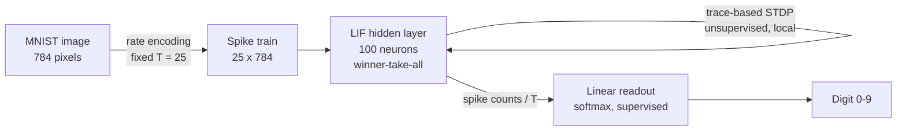

# Biologically Plausible Secure MPC for Efficient Privacy-Preserving AI Training II

**Secure training of a Spiking Neural Network with a local learning rule (STDP) under Multi-Party Computation.**


-complete-2ea44f)


B.Sc. thesis project, **Topic II**. This repository holds the full experimental code, from a plaintext
reference implementation (done) towards a secure MPC prototype (next).

> **Status.** Stage 1 (plaintext validation) is complete and reproducible. **No MPC code exists in this
> repository yet**; nothing here makes a security or MPC-cost claim. The secure stages are listed in the
> [roadmap](#roadmap).

---

## Research question

Spiking neural networks are *sparse*: few neurons spike per timestep. It is tempting to conclude that
sparse computation is automatically cheaper under MPC. **That is an assumption, not a result.**
Under MPC, data-dependent control flow (which neuron spiked, when, how many) can leak information, and
hiding it (fixed-length, oblivious execution) can remove the very savings sparsity promises.

This project asks, with measurements:

> Does an SNN trained with a local, biologically plausible rule (STDP) actually reduce MPC cost compared
> with a conventional ANN **after** accounting for leakage protection, communication and secure control flow?

A negative answer is a valid outcome of this thesis.

## What exists today (Stage 1, plaintext)

A complete, tested, from-scratch pipeline on MNIST. Every operation of the LIF layer and the learning rule
is written explicitly (no framework magic) because each one has to be re-implemented as a secure operation later.



| Component | File | What it does |
|---|---|---|
| Config | [configs/experiment_config.yaml](configs/experiment_config.yaml) | Single source of truth for every hyperparameter |
| Encoding | [src/encoding.py](src/encoding.py) | Rate coding: a pixel spikes with probability equal to its intensity, for a fixed `T` |
| LIF layer | [src/lif_model.py](src/lif_model.py) | `u = beta*u + I`, threshold compare, reset, winner-take-all, adaptive threshold |
| STDP | [src/stdp.py](src/stdp.py) | Trace-based local rule; only the winning neuron updates, using only its own spike and its inputs' traces |
| Readout | [src/readout.py](src/readout.py) | Linear softmax classifier, the only step that uses labels; also precision / recall / F1 |
| ANN baseline | [src/ann_model.py](src/ann_model.py) | 784 -> 100 (ReLU) -> 10, Adam + backprop |
| Dashboard | [src/app_server.py](src/app_server.py), [src/web/index.html](src/web/index.html) | Local web UI that runs the real code above, phase by phase |

### The model in three equations

```
Membrane   u_i[t] = beta * u_i[t-1] + sum_j W[j,i] * s_j[t]
Spike      s_i[t] = 1  if  u_i[t] >= threshold + theta_i,  else 0       (then reset)
STDP       W[:,j] += lr * (trace - x_target) * (w_max - W[:,j])^mu      (winner j only)
```

`theta_i` is a per-neuron adaptive threshold that rises each time neuron `i` wins, which keeps the neurons
from all learning the same digit. After each image, every neuron's incoming weights are rescaled to a fixed sum.

## Results (plaintext, MNIST)

Measured on the full official 10,000-image test set. Training uses 5,000 images (validation: 1,000),
fixed seeded split, **`seed: 0`**, CPU (4 threads), default values from the config file.

| Model | Learning | Test accuracy | Training time |
|---|---|---:|---:|
| ANN 784-100-10 (ReLU) | backprop, supervised | **92.96 %** | 1.6 s (20 epochs) |
| SNN: STDP hidden layer + linear readout | local STDP (unsupervised) + supervised readout | **80.90 %** (macro-F1 80.6 %) | 13.1 s STDP (1 epoch) + 6.5 s readout |
| Control: *untrained* random hidden layer + same readout | readout only | 55.68 % | n/a |

How to read this:

- **The control matters.** It isolates what STDP contributes: +25 points over a random hidden layer with
  an identical readout. Without it, the SNN number would not show that anything was learned.
- **The ANN wins on accuracy here**, and this is expected: it is trained end-to-end with labels. The thesis
  is not about beating the ANN in plaintext; it is about what each approach costs when run securely.
- Most SNN errors are between visually similar digits (4 vs 9, 3/5/8). The unsupervised layer groups
  look-alikes together and the readout cannot always separate them.
- **These numbers are preliminary.** The STDP hyperparameters (`learning.*`) have not been tuned; the SNN was
  trained for a single epoch. The ANN over-fits the small training set (99.5 % train vs 91.8 % validation).
- Not yet measured: variance over multiple seeds. Treat single-run differences of ~1 point as noise.

### SNN activity and plaintext operation counts (per image)

| Quantity | Value |
|---|---:|
| Input spikes (T = 25) | ~2,597 |
| Hidden spikes (winner-take-all) | ~4.0 |
| Hidden neurons that ever fired | 99 / 100 |
| Dense synaptic additions (every weight, every step) | 1,960,000 |
| Event-driven synaptic additions (only where an input spiked) | 259,740 |
| ANN multiplications (for comparison) | 79,400 |

> **Caution.** These are *plaintext* operation counts. They are **not** an MPC cost. Under MPC the
> event-driven count is not directly usable, because skipping work for silent inputs reveals which inputs
> were silent. Whether sparsity helps securely is exactly what Stages 3-6 will measure.

## Quick start

Requires Python 3.12 and about 65 MB of disk for MNIST. CPU is sufficient.

```bash
git clone --recurse-submodules https://github.com/Pedro4O4/Biologically-Plausible-Secure-MPC-for-Efficient-Privacy-Preserving-AI-Training.git
cd Biologically-Plausible-Secure-MPC-for-Efficient-Privacy-Preserving-AI-Training

python3 -m venv .venv
source .venv/bin/activate
pip install -r requirements.txt

python scripts/download_mnist.py        # one-time dataset download into data/
python -m unittest discover -s tests -v # 13 tests, a few seconds
python src/app_server.py                # dashboard on http://127.0.0.1:8000
```

`--recurse-submodules` is only needed for the MP-SPDZ checkout used in the later stages; the plaintext
pipeline does not depend on it.

### Using the dashboard

Open <http://127.0.0.1:8000>. The dashboard grows one phase at a time; each tab runs the real project code.

| Tab | What you can do |
|---|---|
| Phase 0 · Encoding | Inspect an MNIST digit and its spike raster; change the sample and timestep |
| Phase 1 · ANN | Train the backprop baseline and watch accuracy, per-digit recall |
| Phase 2 · LIF | Watch the hidden layer spike over time; click a neuron to inspect it; preview leak and threshold |
| Phase 3 · STDP | Train unsupervised; watch the 100 neurons' weights turn into digit-like features |
| Phase 4 · Readout | Train the readout; compare ANN vs SNN vs control; confusion matrix; operation counts |

**Training never starts on its own**; it only runs when you press the Train button. A different port can be
passed as the first argument: `python src/app_server.py 8001`. Trained models and metrics are saved in
`results/` and reloaded on the next start (that folder is git-ignored).

## Configuration

All experiment parameters live in [configs/experiment_config.yaml](configs/experiment_config.yaml) and are
read by every script. Nothing is hard-coded in the model files. Key settings:

| Key | Default | Meaning |
|---|---|---|
| `simulation.num_steps` | 25 | Fixed time window `T`. Independent of the input by design (see [Security notes](#security-and-leakage-notes)) |
| `architecture` | 784 / 100 / 10 | Inputs / hidden LIF neurons / classes |
| `seed` | 0 | Controls the data split and weight initialisation |
| `neuron.beta`, `neuron.threshold` | 0.9, 50.0 | Leak and spike threshold (Phase 2) |
| `learning.*` | see file | STDP rate, trace decay, soft bound, threshold bonus (Phase 3) |
| `readout.*` | see file | Readout optimiser settings (Phase 4) |

To reproduce the table above, use `seed: 0` and the committed defaults, then press Train in Phases 1, 3 and 4.

## Repository layout

```
configs/    experiment_config.yaml        all hyperparameters
src/        encoding, lif_model, stdp, readout, ann_model, data, config_loader
            app_server.py + web/          local dashboard
tests/      test_lif, test_stdp, test_readout   (unit tests, 13 total)
scripts/    download_mnist.py, snntorch_sanity_check.py
MP-SPDZ/    MPC framework (git submodule; used from Stage 2 onwards)
results/    generated models and metrics (git-ignored)
```

## Roadmap

The thesis follows six stages. Stage 1 is split into the dashboard's Phases 0-4.

| Stage | Goal | Status |
|---|---|---|
| 1 | Plaintext validation: dataset, encoding, LIF, STDP, readout, ANN baseline | **Done** (hyperparameters not yet tuned) |
| 2 | Secure baseline: small conventional NN under MPC | Not started |
| 3 | Microbenchmarks of secure SNN parts: membrane update, threshold, reset, local weight update | Not started |
| 4 | End-to-end secure SNN training prototype | Not started |
| 5 | Profiling, bottleneck analysis, at least one measured optimisation | Not started |
| 6 | Comparison: plaintext ANN / plaintext SNN / secure ANN / secure SNN (accuracy, time, communication, rounds, leakage) | Not started |

Optional extensions (only if time allows): Fashion-MNIST, N-MNIST, surrogate-gradient SNN reference,
a second MPC protocol, hardware energy measurement. Energy is only reported if a real measurement setup exists.

## Security and leakage notes

These are design constraints for the secure stages, recorded here so the plaintext code stays compatible with them.

- **Fixed-length execution.** The simulation always runs exactly `T` steps, whatever the input. The amount of
  computation therefore does not reveal anything about the input.
- **Data-dependent sparsity can leak.** When spikes occur, where they occur, and how many occur are all
  potentially sensitive. A secure implementation must either hide them (oblivious handling, which costs
  communication and computation) or document them explicitly as released information.
- **Candidate setting, not a claim.** The initial MPC candidate is MP-SPDZ with a 3-party, honest-majority,
  semi-honest protocol. The final protocol, party count and adversary model will be fixed after feasibility
  testing and supervisor approval. No stronger security than the chosen protocol provides will be claimed.
- **Public vs private** values (inputs, membrane potentials, spike events, weight updates, released outputs)
  will be listed explicitly once the secure prototype exists.

## Tech stack

Python 3.12, PyTorch (CPU), PyYAML, matplotlib, MP-SPDZ. The LIF layer is written by hand; snnTorch is used
only as an optional cross-check in `scripts/snntorch_sanity_check.py`. The dashboard uses only the Python
standard library and a single static HTML page (no framework, no build step).

## Author

Pedro ([@Pedro4O4](https://github.com/Pedro4O4)). B.Sc. Computer Science, IT Security.
